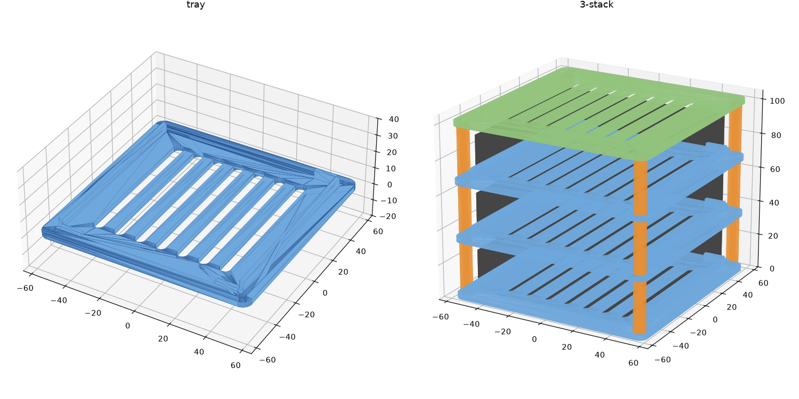

# torne-cases

Sony torne (CECH-ZD1J, 実測 99 x 99 x 24 mm) を積み重ねて固定するラック。Raspberry Pi クラスタケース風。
Bambu Lab A1 mini (180 x 180 x 180 mm) で印刷できるサイズにしている。



## 部品

| ファイル | 枚数 | 内容 |
| --- | --- | --- |
| `stl/tray.stl` | torne の台数 | 棚板 118 x 118 x 3 mm (ガイド内のり 100 x 100 mm、片側 0.5 mm のすき間)。左右ガイド、背面ストッパー (高さ 5 mm)、前面ストッパー (2 mm)、通気スリット付き |
| `stl/lid.stl` | 1 | 最上段のフタ |
| `stl/spacer.stl` | 4 x 台数 | 柱 (OD 7 / ID 3.4 / 長さ 30 mm)。既製スタンドオフを使う場合は不要 |

固定穴は M3 用 φ3.4、ピッチ 108 x 108 mm (柱は torne の四隅のすぐ外)。段ピッチは 33 mm (柱 30 + 板 3)。
背面中央は開けてあるので、アンテナ線と USB ケーブルはそこから出す。torne は少し持ち上げて前に引き出す。

## 固定方法

- 既製品: M3 オス-メス スタンドオフ 30 mm を各段 4 本。最下段は M3 ネジで下から留める
- 印刷: `spacer.stl` を挟み、M3 全ネジ (段数 x 33 + 10 mm 程度) かナットで締める

## 生成

```sh
uv run torne_stack.py          # stl/ に出力
uv run --with pytest --with manifold3d --with numpy pytest
```

寸法は `torne_stack.py` 冒頭の定数で変更できる。手持ちのスタンドオフ長に合わせる場合は `GAP` を変える (27 mm 以上)。

## 推奨印刷設定

PETG (torne は発熱するため PLA より無難)、0.2 mm レイヤー、壁 3 周、インフィル 20%、サポート不要。
