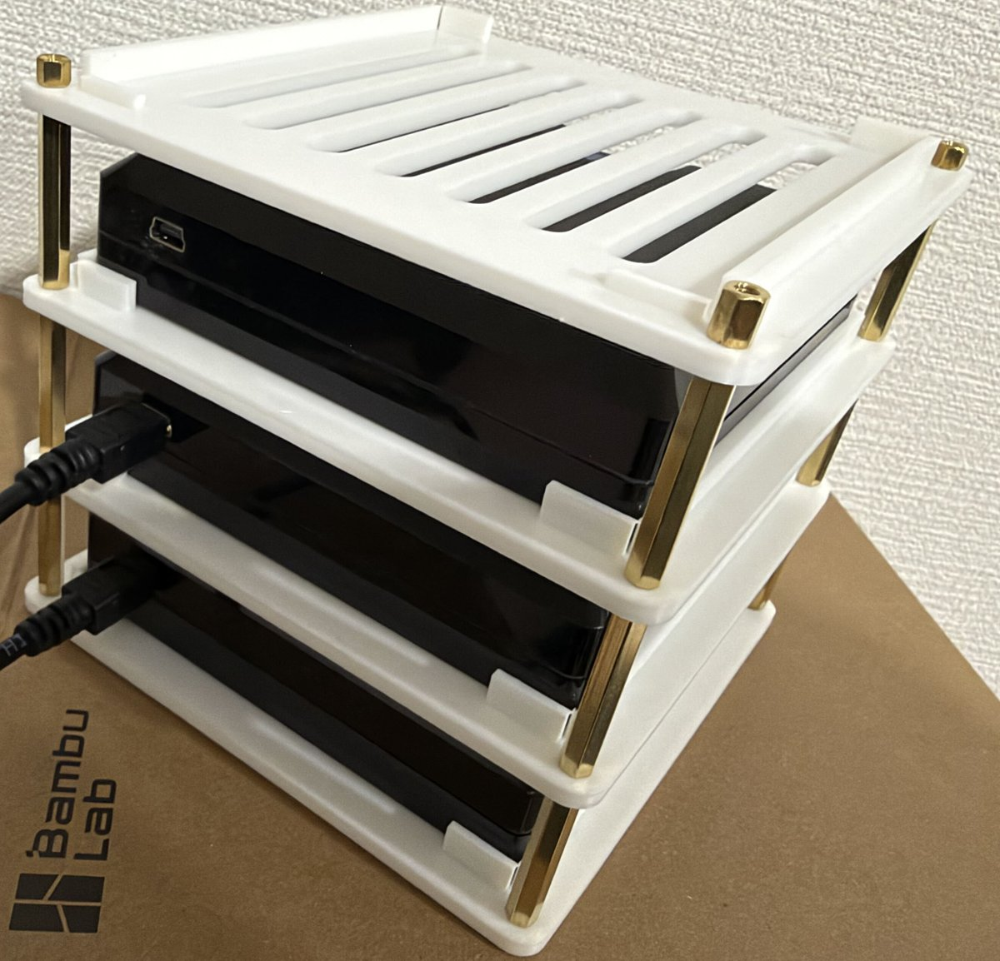

# torne-cases

English | [日本語](README.ja.md)

**A 3D-printable stacking rack for Sony torne, inspired by Raspberry Pi cluster cases.**

Stack as many torne (CECH-ZD1J) units as you like, held in place by M3 standoffs. Every part fits on a Bambu Lab A1 mini (180 x 180 x 180 mm) build plate.

<p align="center">
  
</p>


## Features

- **Stackable**: one tray per torne, joined with off-the-shelf M3 standoffs or printed spacers
- **Snug fit**: side guides and front/rear stoppers sized from a measured 99 x 99 x 24 mm unit, with 0.5 mm clearance per side
- **Easy access**: lift a torne slightly and slide it out the front without taking the rack apart
- **Cable friendly**: the center of the rear is open for antenna and USB cables
- **Ventilated**: slots in every tray and in the lid
- **Parametric**: all dimensions are constants in a single Python script

## Bill of materials

### Printed parts

| File | Quantity | Description |
| --- | --- | --- |
| `stl/tray.stl` | 1 per torne | 118 x 118 x 3 mm shelf with side guides, a 5 mm rear stopper, a 2 mm front stopper and ventilation slots |
| `stl/lid.stl` | 1 | Top lid |
| `stl/spacer.stl` | 4 per torne | Pillar, OD 7 / ID 3.4 / 30 mm. Not needed if you use standoffs |

Pre-built STL files are in [`stl/`](stl/).

### Hardware

| Part | Quantity | Example |
| --- | --- | --- |
| M3 x 30 mm male-female hex standoff (+6 mm thread) | 4 per torne | [uxcell, brass, 10 pcs](https://www.amazon.co.jp/dp/B078T9NN35) |
| M3 x 5 mm pan head screw | 4 | [uxcell, 304 stainless, 20 pcs](https://www.amazon.co.jp/dp/B0DZP3P75T) |
| M3 hex nut | 4 | Any |

If you use printed spacers instead, you need an M3 threaded rod (about `levels x 33 + 10` mm) or bolts and nuts.

## Assembly

1. Fix four standoffs to the bottom tray from below with M3 screws.
2. Place a torne on the tray, with its back facing the open side.
3. Place the next tray over the standoff threads, then screw four more standoffs onto them to clamp it.
4. Repeat for each torne. Place `lid.stl` on top and fasten it with M3 nuts.

Mounting holes are φ3.4 mm on a 108 x 108 mm pitch, just outside the corners of the torne. Each level adds 33 mm (30 mm standoff + 3 mm tray).

## Printing

| Setting | Value |
| --- | --- |
| Material | PETG (recommended over PLA because torne gets warm) |
| Layer height | 0.2 mm |
| Walls | 3 |
| Infill | 20% |
| Supports | None |

## Customization

The STL files are generated by [`torne_stack.py`](torne_stack.py) with [manifold3d](https://github.com/elalish/manifold). You only need [uv](https://docs.astral.sh/uv/) to run it.

```sh
uv run torne_stack.py   # writes STL files to stl/
```

Edit the constants at the top of the script to change the dimensions. For example, set `GAP` to the length of your standoffs (27 mm or more).

## Development

```sh
uv run --with pytest --with manifold3d --with numpy pytest
```

## License

[MIT](LICENSE)

## Disclaimer

This is an unofficial project and is not affiliated with, endorsed by, or sponsored by Sony Interactive Entertainment or Sony Group Corporation. "torne" is a trademark of its respective owner.
